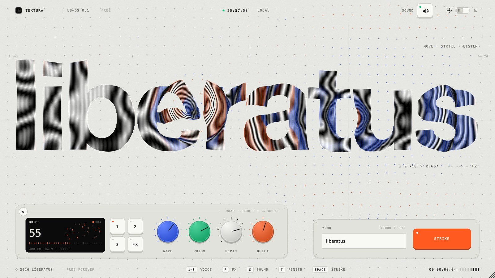
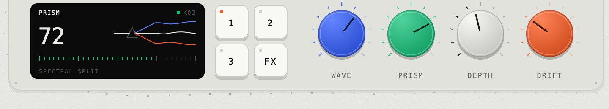
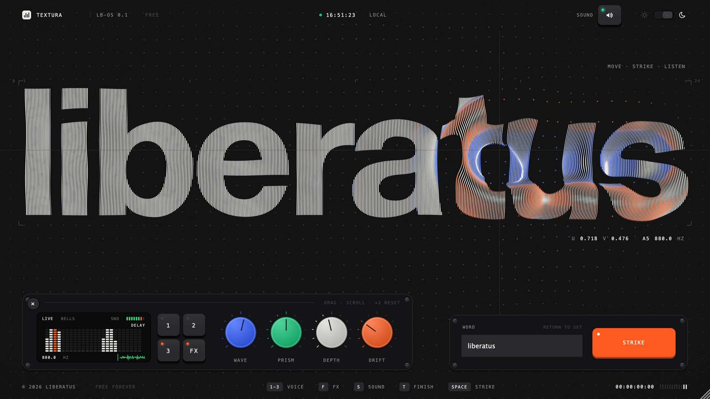
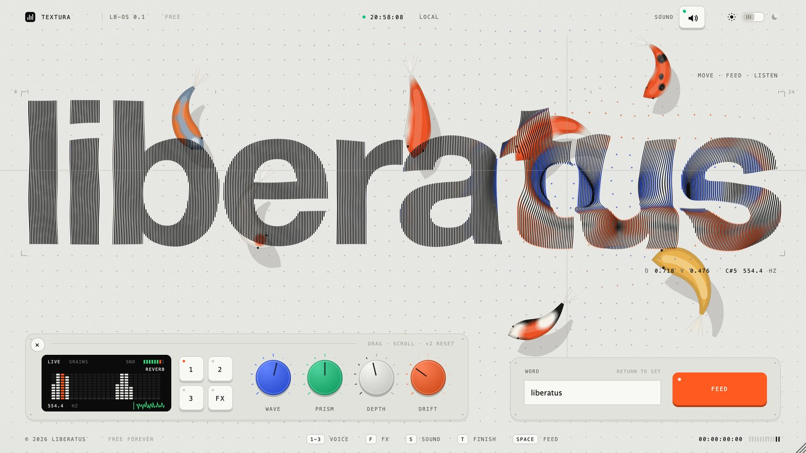

# Textura

**A word you can play.** Move the pointer across it and it sounds and ripples. Free instrument
for Mac and Windows: VST3, AU and standalone. No account, no mailing list, no price.

Textura is a project by [Liberatus](https://github.com/l-i-b-e-r-a-t-u-s). *Made to be given away.*

## Get it

Download the installer for your machine from the
[Releases page](https://github.com/l-i-b-e-r-a-t-u-s/Textura/releases).

- **Mac** (Apple silicon and Intel): `Textura-1.0.1-mac.pkg` installs the AU, the VST3 and the
  app. It is not notarised, so the first time, right-click it and choose Open.
- **Windows** (64-bit): `Textura-1.0.1-windows.exe` installs the VST3 and the app. Windows may
  warn that the publisher is unknown; choose More info, then Run anyway.

Then rescan plugins in your DAW and look for **Textura** by Liberatus, under instruments.

## Play it

- **Move** over the word and notes spray out. How far you travel sets how often, how fast you
  move sets how hard, your height picks the note, and the letter you are over picks the chord
  (four chords, spread across the word).
- **Strike** by clicking anywhere, or pressing Space: a six-note strum and a ripple from that
  point.
- **1 / 2 / 3** choose the voice. Grains is a plucked tone with an octave shimmer, Keys is an
  electric piano with a bass note on the strum, Bells is three inharmonic partials on one scale.
- **FX** switches between a room reverb and a ping-pong delay.
- **WORD**: type any word, up to 16 characters, and press Return. The chords follow its letters
  and the notes follow its shape, so every word plays differently.
- **MIDI** plays the current voice chromatically, so it also works as an ordinary instrument.

| Knob | What you hear | What you see |
|---|---|---|
| **WAVE** | note decay, reverb length or delay time | ripple speed and ring time |
| **PRISM** | brightness and stereo spread | how far the ink splits into two colours |
| **DEPTH** | amount of reverb or delay | relief and camera lean |
| **DRIFT** | note scatter, density and detune | ambient rain on the surface |

Drag or scroll a knob; double-click resets it. While you turn one, the screen shows what it is
doing:

Keys: **S** sound on and off, **T** light and dark, **F** reverb or delay, **K** the pond.

## Hidden

- Click the badge in the top left corner (or press K) to open the pond. Koi wander under the
  page, gather round a resting pointer and peck at it, and scatter from strikes and fast sweeps.
- Click the name next to the badge to switch a click from STRIKE to FEED. Pellets drop, the koi
  eat them, and each bite leaves a small ripple.
- Leave the standalone alone for twenty seconds and it plays itself. It never does this inside
  a DAW.
- Type `liber`.

## Good to know

- Keys, knobs and switches click, and those clicks are part of the instrument's output, so they
  will print into a recording. Turn SOUND off to silence them.
- The word is set in Helvetica Neue Bold on a Mac and in Inter Bold (bundled) on Windows. Notes
  follow the letter shapes, so the same word plays a little differently on each.
- The Windows build has been compiled and checked offline, with less hands-on testing than the
  Mac build so far. If something is off, open an issue.

## Build it yourself

You need CMake and a C++20 compiler. JUCE 9.0.2 is used from `~/JUCE` if it is there and is
fetched otherwise.

Mac (Xcode command line tools, Ninja):

    cmake -S . -B build -G Ninja -DCMAKE_BUILD_TYPE=Release "-DCMAKE_OSX_ARCHITECTURES=arm64;x86_64"
    cmake --build build
    tools/install.sh           # this machine only; quit your DAW first
    tools/package_mac.sh       # dist/Textura-1.0.1-mac.pkg

Windows (Visual Studio 2022 with C++, Git; Inno Setup for the installer):

    tools\build_windows.bat

Pushing a tag that starts with `v` builds both installers on GitHub and attaches them to a
release.

There is an offline harness that needs no DAW and no audio device. It runs the boot screen,
the intro wipe, a five second pointer sweep and a strike, and writes what was drawn (PNG) and
played (WAV):

    build/TexturaSnapshot_artefacts/Release/TexturaSnapshot out.png out.wav [1-3] [dark] [delay] [koi] [code] [ticks] [knob] [bench]

## How it works

The word is cut into thin vertical columns of ink. Underneath is a membrane: a wave equation
on a coarse grid, which the pointer pushes and strikes ring. The membrane bends the columns and
splits them into two colours down its slopes. The sound side reads the same word: where each
letter sits, and how much ink each of 24 height bands holds at the pointer.

- `Source/Engine.h`: voices, room impulse, delay, glue compressor, safety shaper.
- `Source/Field.h`: the membrane and the word outline.
- `Source/PluginEditor.cpp`: pointer to notes, and all drawing.
- `Source/Koi.h`: the pond.
- `Source/Ticks.h`: the interface's own clicks.
- `tools/Snapshot.cpp`: the offline harness.

## Licence

AGPL-3.0, which is also the licence JUCE is used under. Inter is under the SIL Open Font
License (`assets/Inter-LICENSE.txt`). The creature in `assets/creature.png` belongs to
Liberatus.
